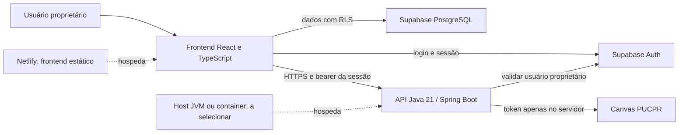

# Arquitetura atual — CampusFlow

## Decisão

O pedido mais recente define **Java 21 no backend**, frontend TypeScript/JavaScript e diretórios separados. O protótipo anterior de API TypeScript/Netlify Functions é histórico e não é a arquitetura atual.

A tabela descreve responsabilidades do código. Não comprova que os serviços hospedados estejam criados ou conectados.

| Componente | Local | Responsabilidade |
|---|---|---|
| Frontend | `frontend/` | Interface responsiva, login, tarefas, prazos, leitura/importação Canvas, revisão e confirmação |
| Backend | `backend/` | Endpoints `/api/*`, autenticação, verificação do proprietário, chamada Canvas, validação e proteção de segredos |
| Dados | `supabase/` | Migração da tabela de trabalhos e políticas de isolamento por usuário |
| Ferramentas | `scripts/` | Startup e toolchain Java/Maven verificável, caches graváveis, sem alterar `HOME` |
| Netlify | `netlify.toml` | Build de `frontend/` pelo workspace raiz e publicação de `frontend/dist` |
| Testes | Frontend, backend e testes SQL | Evidências separadas para interface, API e isolamento do banco |

## Comunicação e configuração

Em desenvolvimento, o frontend usa a origem local na porta 8888 e encaminha `/api/*` para o backend na porta 8080. Em produção, `VITE_API_BASE_URL` deve conter a origem HTTPS efetiva da API Java. O backend autoriza apenas as origens explicitamente listadas em `APP_ALLOWED_ORIGINS`; não se usa `*` para liberar autenticação indiscriminadamente.

O Netlify desta configuração **não executa JVM**. Não se transforma Spring Boot em função Node nem se deixa uma função antiga esconder essa limitação. Enquanto não houver host Java configurado, um pedido relativo `/api/*` ao frontend Netlify recebe resposta 404. A regra fica antes do fallback da SPA.

`VITE_*` é configuração pública de build. O token Canvas, senhas e chaves administrativas nunca podem usar esse prefixo. A sessão Supabase autentica a API, e o UUID proprietário protege o token pessoal da faculdade. Um usuário de outro projeto ou outra conta não deve conseguir usá-lo.

## Escopo e publicação

O texto genérico do template pede publicação Netlify, mas sua linha específica de fora do escopo exclui CI/CD e deploy direto. Nesta revisão prevalece essa linha específica. O workflow anterior e a configuração Dependabot foram movidos para `docs/archive/`, fora de `.github/`, preservando o histórico sem automação ativa.

A preparação local, o build de artefatos, a criação de recursos e a publicação são etapas distintas. Um build Java não comprova host Java provisionado; um build frontend não comprova site Netlify publicado; token Canvas não autentica os painéis Supabase ou Netlify.

## Pendências de arquitetura

- Selecionar o host JVM/container e sua origem HTTPS sem inventar domínio ou plano de cobrança.
- Confirmar origem Canvas e acesso real às atividades Poliweek de teste.
- Configurar Supabase hospedado, conta proprietária e URL pública do frontend.
- Definir o alcance da leitura por IA, provedor/modelo e dados autorizados antes de afirmar análise automática.
- Esclarecer o significado de “certificado no banco”; o pedido não define certificado cliente, PKI ou um formato de registro.
